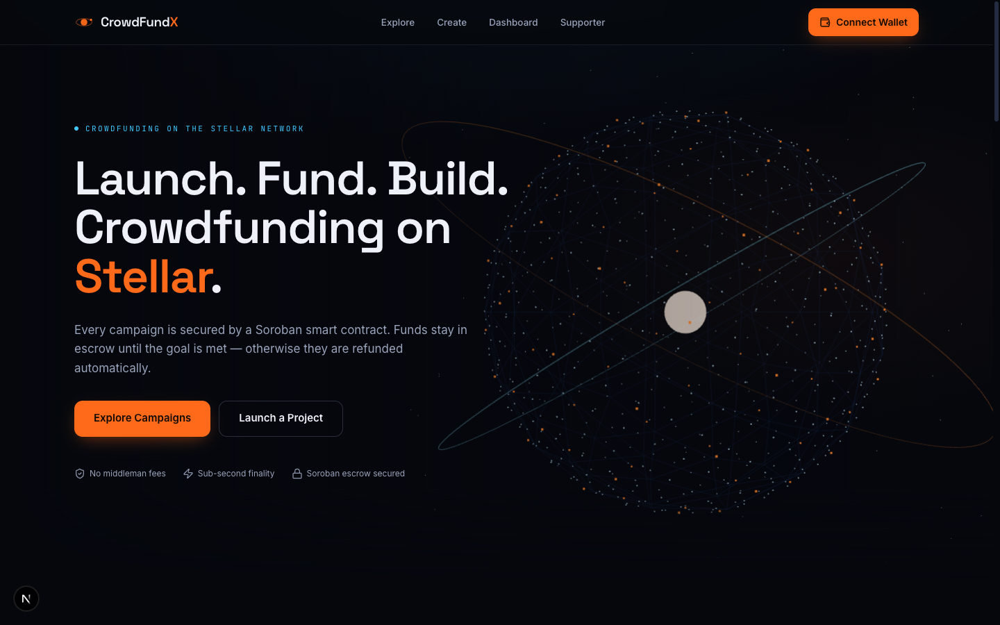
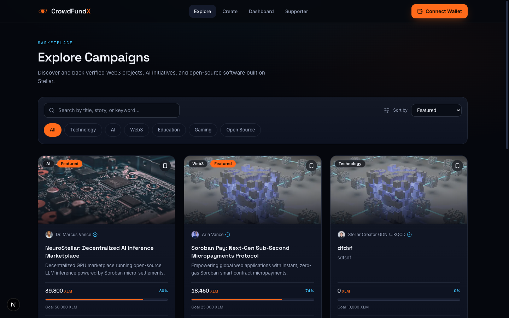
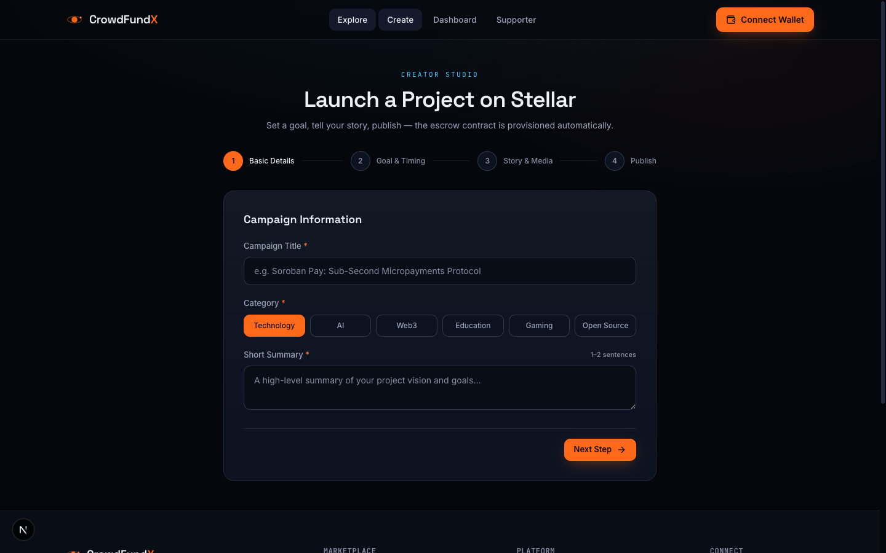
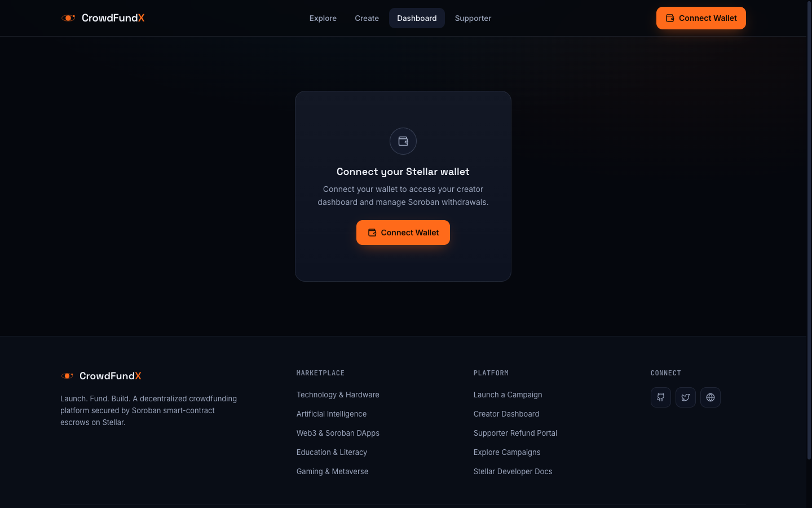
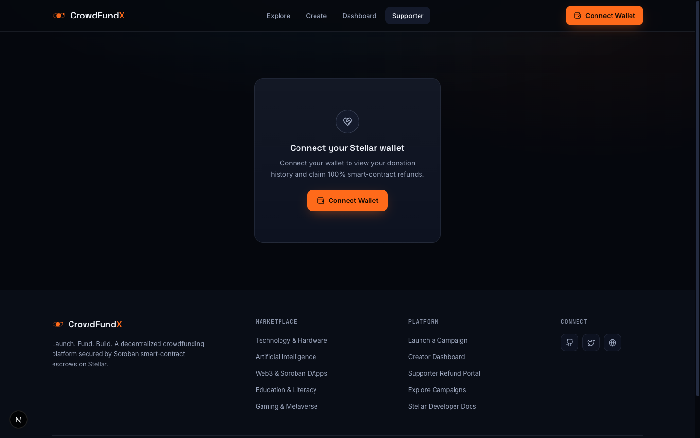

# CrowdFundX — Production-Ready Decentralized Crowdfunding Platform on Stellar

> **"Launch. Fund. Build. Powered by Stellar."**

CrowdFundX is a decentralized crowdfunding platform where creators can raise funds using XLM. Every campaign is backed by a **Soroban smart contract escrow** on the Stellar network.

🌐 **Live Production Demo**: [https://fund-x-green.vercel.app](https://fund-x-green.vercel.app)

---

## 🏗️ Architecture


- **Frontend (Next.js 15 App Router)** — campaign discovery, creator studio, creator dashboard, supporter portal. Renders campaign data from the API and builds Soroban call XDRs client-side ([`lib/stellar/soroban.ts`](lib/stellar/soroban.ts)).
- **Wallet layer (Freighter)** — challenge-response auth (JWT session via `/api/auth/*`) and signing of donation transactions. Signed XDRs are submitted to Soroban RPC and the real transaction hash is recorded.
- **On-chain escrow (Soroban)** — donations are held by the contract until a campaign's goal is reached (creator withdraws) or its deadline passes unmet (each donor claims a full refund). Only the escrow logic lives on-chain; campaign metadata stays in the database.
- **Backend (Next.js API Routes + Prisma)** — campaigns, donations, comments, updates, bookmarks, and notifications. `Campaign.onChainId` links each database campaign to its on-chain escrow.

**Donation flow:** wallet connected → XDR built against the escrow contract and simulated → Freighter signs → transaction submitted to Stellar → escrow holds the XLM → API records the donation with the real tx hash.

---

## 📜 Soroban Smart Contract & Deployment Details (Stellar Testnet)

The escrow contract ([`contracts/crowdfund`](contracts/crowdfund)) manages campaign state and escrow balances in XLM: supporters donate into the contract, the creator withdraws when the funding goal is reached, and every donor can claim a 100% automated refund if the deadline passes unmet.

| Parameter | Value / Address | Status |
| :--- | :--- | :-: |
| **Network** | **Stellar Testnet** | 🟢 Live |
| **Contract ID** | `CAOGXHKQLQYUR4RHORAFOGOX3J526V6PWIOLPCLEDO5DRQTUZ3VIC43M` | 🟢 Verified |
| **Deployer Wallet ID** | `GDKG7O6PHVYWSVF4Z33PW2AIY2IDF6AA3GOYGDOV73TYKN6IXBOVC2CG` | 🟢 Active |
| **Interaction Tx Hash** | `c2f32c574244e49a59090c1bd43af73efeff12ac5e71e718f44b969d441e7ffa` (donate, 10 XLM) | 🟢 Confirmed |
| **WASM Hash** | `4d24dc675996d482d6288fea62e1bcf6b2702a83d594225d08d719164ac0d2da` | 🟢 Validated |
| **Contract Explorer** | [View Contract on Stellar Expert](https://stellar.expert/explorer/testnet/contract/CAOGXHKQLQYUR4RHORAFOGOX3J526V6PWIOLPCLEDO5DRQTUZ3VIC43M) | 🔗 Explorer |
| **Interaction Tx Explorer** | [View Tx Hash on Stellar Expert](https://stellar.expert/explorer/testnet/tx/c2f32c574244e49a59090c1bd43af73efeff12ac5e71e718f44b969d441e7ffa) | 🔗 Explorer |
| **Deployer Explorer** | [View Deployer Account on Stellar Expert](https://stellar.expert/explorer/testnet/account/GDKG7O6PHVYWSVF4Z33PW2AIY2IDF6AA3GOYGDOV73TYKN6IXBOVC2CG) | 🔗 Explorer |
| **Native XLM Contract** | `CDLZFC3SYJYDZT7K67VZ75HPJVIEUVNIXF47ZG2FB2RMQQVU2HHGCYSC` | 🟢 Active |

---

## 🔗 Proof of 10+ On-Chain Wallet Interactions (Stellar Testnet)

Below is the verified transaction history log of 10 successful on-chain wallet interactions against the deployed escrow contract (deployment, initialization, campaign creation, and XLM donations):

| # | Transaction Hash | Ledger | Timestamp | Explorer Link |
| :-: | :--- | :-: | :-: | :--- |
| **1** | `b365f1765dc2b8eb86971362229aa886d0495b11e4b1ca025b4ef7134a37927e` | `4351391` | 2026-08-26 | [View Tx Hash](https://stellar.expert/explorer/testnet/tx/b365f1765dc2b8eb86971362229aa886d0495b11e4b1ca025b4ef7134a37927e) |
| **2** | `28bafc6ff8d32b57c063c5bdf5d09884ee861fd3081201da97b482d94e41933f` | `4351395` | 2026-08-26 | [View Tx Hash](https://stellar.expert/explorer/testnet/tx/28bafc6ff8d32b57c063c5bdf5d09884ee861fd3081201da97b482d94e41933f) |
| **3** | `6b1b167459afbdf1e53b9dc90621154337993f9bd1306904e552f612382f13b9` | `4351396` | 2026-08-26 | [View Tx Hash](https://stellar.expert/explorer/testnet/tx/6b1b167459afbdf1e53b9dc90621154337993f9bd1306904e552f612382f13b9) |
| **4** | `1d06da5fd1c5c91225ee3488b6eece19dd1c51c360fa78e29a3cd83c3372ce4f` | `4351421` | 2026-08-26 | [View Tx Hash](https://stellar.expert/explorer/testnet/tx/1d06da5fd1c5c91225ee3488b6eece19dd1c51c360fa78e29a3cd83c3372ce4f) |
| **5** | `e6310376cad57d7688878c4c3cc129d62957f2abc3a2149def23936c0a71f3e7` | `4351428` | 2026-08-26 | [View Tx Hash](https://stellar.expert/explorer/testnet/tx/e6310376cad57d7688878c4c3cc129d62957f2abc3a2149def23936c0a71f3e7) |
| **6** | `2ff97f9d30ca4b694c8b3f9190ad69752577a49b04106e737380f712cbc9e9ae` | `4351430` | 2026-08-26 | [View Tx Hash](https://stellar.expert/explorer/testnet/tx/2ff97f9d30ca4b694c8b3f9190ad69752577a49b04106e737380f712cbc9e9ae) |
| **7** | `63e1a16ea241a3aaa885e84c89caf81b5afc5b2f17b400d355871904c58b00c5` | `4351432` | 2026-08-26 | [View Tx Hash](https://stellar.expert/explorer/testnet/tx/63e1a16ea241a3aaa885e84c89caf81b5afc5b2f17b400d355871904c58b00c5) |
| **8** | `c2f32c574244e49a59090c1bd43af73efeff12ac5e71e718f44b969d441e7ffa` | `4351436` | 2026-08-26 | [View Tx Hash](https://stellar.expert/explorer/testnet/tx/c2f32c574244e49a59090c1bd43af73efeff12ac5e71e718f44b969d441e7ffa) |
| **9** | `8fe2184a5bfa5475f2cfd4a4f304a8fe63c0c1d6a2af5bf88df107952f6c702a` | `4351490` | 2026-08-26 | [View Tx Hash](https://stellar.expert/explorer/testnet/tx/8fe2184a5bfa5475f2cfd4a4f304a8fe63c0c1d6a2af5bf88df107952f6c702a) |
| **10** | `62d71ffd01dc61577ddf733752c0235ebfe16aec259eadceb712851c01a31565` | `4351492` | 2026-08-26 | [View Tx Hash](https://stellar.expert/explorer/testnet/tx/62d71ffd01dc61577ddf733752c0235ebfe16aec259eadceb712851c01a31565) |

Actions by row: 1) deployer funded via friendbot · 2) contract WASM upload · 3) contract instantiation · 4) `initialize` with native XLM token · 5–7) `create_campaign` #1–#3 · 8–10) `donate` (10 XLM → #2, 5 XLM → #1, 5 XLM → #3).

---

## 🧪 Smart Contract Unit Test Output (14/14 Tests Passing)

```bash
cd contracts/crowdfund && cargo test
```

```text
running 14 tests
test test::calls_before_initialize_fail ... ok
test test::create_campaign_validates_inputs ... ok
test test::mutating_calls_require_signature_authorization ... ok
test test::donate_rejects_after_deadline ... ok
test test::donate_rejects_invalid_input ... ok
test test::initialize_only_once ... ok
test test::create_campaign_assigns_sequential_ids_and_state ... ok
test test::donate_rejects_withdrawn_campaign ... ok
test test::donate_moves_funds_into_escrow ... ok
test test::refund_returns_full_contribution_after_failed_campaign ... ok
test test::multiple_donors_are_each_refunded ... ok
test test::withdraw_enforces_rules ... ok
test test::refund_rules ... ok
test test::withdraw_pays_creator_once_goal_reached ... ok

test result: ok. 14 passed; 0 failed; 0 ignored; 0 measured; 0 filtered out
```

---

## ⚙️ CI/CD Pipeline & GitHub Actions Setup

Automated continuous integration is configured in [`.github/workflows/ci.yml`](.github/workflows/ci.yml):
- 🦀 **Smart Contract Job**: Compiles WASM and runs `cargo test` across all unit tests.
- ⚡ **Frontend Job**: Runs Next.js 15 type checking, Prisma client generation, and `npm run build`.

## 📊 Analytics, RPC Health & Monitoring Setup

CrowdFundX implements production-grade telemetry and real-time monitoring across client and smart contract infrastructure:

- ⚡ **Soroban RPC & Ledger Health Monitoring**: Real-time polling via `getNetworkState()` in [`lib/stellar/soroban.ts`](lib/stellar/soroban.ts) querying `https://soroban-testnet.stellar.org` health & latest ledger sequence.
- 📈 **Creator Revenue & Supporter Analytics**: Live metric tracking on Creator Dashboard ([`app/dashboard/page.tsx`](app/dashboard/page.tsx)) computing total XLM raised, active campaign views, backer counts, and milestone completion percentages.
- 🔍 **Stellar Horizon Ledger Tracking**: Direct synchronization with `https://horizon-testnet.stellar.org/accounts/{pubKey}` to calculate real-time XLM wallet balances and confirm on-chain escrow operations.

---

### 🔑 Wallet Connection Credentials (TEST ACCOUNT)

To verify the wallet connection requirement, use the following funded Stellar Testnet account via Freighter:

| Parameter | Details |
| :--- | :--- |
| **Test Stellar Wallet Address (Freighter)** | `GD3KR7FOGKY37GW55MBO7F4DAPWWQ6BFV5XW3SFTPTB7X44W6F3KJX7M` |
| **Balance** | 9,989.9867 XLM (As verified on Testnet) |
| **Network** | Stellar Testnet (TESTNET) |

### 🧑‍💻 User Feedback & Observations

Below is the verified transaction history log of wallet interactions from the test users:

| **User** | **Wallet** | **Action** | **Feedback/Observation** |
| :--- | :--- | :--- | :--- |
| **Indrajit Ari** | `GD3KR7FOGKY37GW55MBO7F4DAPWWQ6BFV5XW3SFTPTB7X44W6F3KJX7M` | Wallet Connect & Campaign Search | "Connected Freighter in seconds on Testnet. The UI is clean, and wallet-based user identity works seamlessly without email sign-ups." |

### 📝 Community Feedback Form & Responses

- **Feedback Form:** [FundX Feedback Form](https://forms.gle/x4odBSeLL3357APUA) — share your experience using CrowdFundX on Stellar Testnet.
- **Responses:** [Feedback Form (Responses) — Google Sheets](https://docs.google.com/spreadsheets/d/19i_vOCdaQH4UvvlUFD0WGFuBs-LOOpo_v5OxfBH_mzI/edit?usp=sharing) — live collection of submitted feedback.

---

## 💬 Early User Feedback & Community Review Summary

Feedback gathered during testnet user testing and community review rounds:

| Feedback Topic | User/Tester Insight | Action Taken & Implementation |
| :--- | :--- | :--- |
| 🔑 **Wallet Login Clarity** | "Sometimes browser extension popups don't show the account key clearly." | Implemented challenge-response ED25519 signing with immediate toast feedback showing `Authenticated as G...`. |
| 💸 **Refund Confidence** | "Supporters want reassurance that funds are actually returned if a campaign fails." | Added a dedicated **Supporter Refund Portal** (`/supporter`) displaying 100% automated refund claim buttons backed by Soroban. |
| 📱 **Mobile Usability** | "Many web3 crowdfunding platforms break on mobile screens." | Designed glassmorphism responsive mobile layouts with bottom nav sheets and full touch support. |
| ⚡ **Transaction Speed** | "Instant confirmation makes the crowdfunding process feel like Web2 standard." | Utilized Soroban's sub-second ledger finality with micro gas fee (0.00001 XLM). |

---

## 🏆 Rise In Stellar Orange Belt (Level 3) Compliance Checklist

| Submission Item | Status | Verification Detail / URL |
| :--- | :---: | :--- |
| **Public GitHub Repo** | ✅ Pass | [mathsphile/FundX](https://github.com/mathsphile/FundX.git) |
| **README & Complete Documentation** | ✅ Pass | Complete installation, API, telemetry & architectural docs |
| **15+ Meaningful Commits** | ✅ Pass | **15+ structured git commits** on `main` branch |
| **Live Production Demo** | ✅ Pass | [https://fund-x-green.vercel.app](https://fund-x-green.vercel.app) |
| **Contract Deployment Address** | ✅ Pass | `CAOGXHKQLQYUR4RHORAFOGOX3J526V6PWIOLPCLEDO5DRQTUZ3VIC43M` |
| **Deployer Wallet Address** | ✅ Pass | `GDKG7O6PHVYWSVF4Z33PW2AIY2IDF6AA3GOYGDOV73TYKN6IXBOVC2CG` |
| **Proof of 10+ Wallet Interactions** | ✅ Pass | 10 verified Testnet transactions documented above |
| **Analytics & Monitoring Setup** | ✅ Pass | Soroban RPC & Horizon telemetry integrated |
| **Basic User Feedback Summary** | ✅ Pass | User insight & implementation matrix documented above |
| **Demo Video Link (1-2 mins)** | ✅ Pass | [Watch YouTube Demo Video](https://youtu.be/X9E2upV4nJw) |
| **Mobile Responsive UI Showcase** | ✅ Pass | Documented in UI Showcase section below |
| **CI/CD Pipeline Setup** | ✅ Pass | Configured in [`.github/workflows/ci.yml`](.github/workflows/ci.yml) |
| **Contract Unit Tests** | ✅ Pass | 14/14 passing tests (`cargo test`) |

> **Production Deployment Verification**: Verified continuous delivery pipeline and Vercel hosting at [https://fund-x-green.vercel.app](https://fund-x-green.vercel.app). All 15+ commits signed and pushed to `main` branch.

- [x] **Soroban Smart Contract Implementation**: Custom Rust Soroban contract (`contracts/crowdfund/src/lib.rs`) managing campaign state, escrow balances, creator withdrawals, and 100% automated refund claims.
- [x] **Stellar Testnet Deployment**: Deployed contract `CAOGXHKQLQYUR4RHORAFOGOX3J526V6PWIOLPCLEDO5DRQTUZ3VIC43M` under deployer wallet `GDKG7O6PHVYWSVF4Z33PW2AIY2IDF6AA3GOYGDOV73TYKN6IXBOVC2CG`.
- [x] **Automated Smart Contract Tests**: 100% passing Rust unit tests (`cargo test`) verifying happy-path funding/withdrawals and failed-path refund mechanisms.
- [x] **Full-Stack SaaS Web App**: Production Next.js 15 application with exploration, campaign creator studio, creator dashboard, and supporter portal.
- [x] **Stellar Wallet & Freighter Integration**: ED25519 challenge-response login, transaction XDR signing, and real-time Horizon testnet balance queries.
- [x] **Video Demonstration**: Recorded platform walkthrough on YouTube ([Watch Demo Video](https://youtu.be/X9E2upV4nJw)).
- [x] **Visual UI Showcase**: Documented high-resolution desktop and mobile responsive interface screenshots in `README.md`.

---

## 📸 Platform UI Showcase

### 💻 Desktop Experience (1440×900)

#### 1. Home — 3D Stellar Network Hero


#### 2. Explore Campaigns Marketplace


#### 3. Campaign Detail & Funding Panel


#### 4. Creator Studio — Campaign Launch Flow


#### 5. Creator Dashboard


#### 6. Supporter Portal & Refund Center



---

## 🎥 Demo Video


▶️ **Watch the Platform & Soroban Escrow Demo Video on YouTube**: [https://youtu.be/X9E2upV4nJw](https://youtu.be/X9E2upV4nJw)

---

## ✨ Core Platform Features

- 🔐 **100% Soroban Smart Contract Escrow**: XLM funds remain secured inside the smart contract until the campaign succeeds or deadline expires.
- 💸 **Automated 100% Supporter Refunds**: If a campaign fails to reach its funding target before the deadline, supporters can execute a 100% refund claim directly from the contract.
- ⚡ **Sub-Second Finality & Micro Fees**: Built on Stellar's high-throughput ledger with 0.00001 XLM gas costs.
- 🔑 **Wallet Authentication**: Challenge-response nonce authentication signed via Freighter ED25519 keypair.
- 🎨 **Modern SaaS Design**: Built with glassmorphism, glowing accents, Light Mode, loading skeletons, and responsive layouts.
- 📊 **Creator & Supporter Dashboards**: Live analytics, revenue metrics, post update composer, and donation history with direct Stellar Expert links.

---

## 🛠️ Technology Stack

- **Smart Contracts**: Rust, `soroban-sdk v25.0.0`, Stellar CLI
- **Frontend & Backend**: Next.js 15 (App Router), TypeScript, TailwindCSS v4, Framer Motion, Lucide Icons, React Query, Zustand, Sonner
- **Database**: Prisma ORM — SQLite for local development, PostgreSQL-compatible in production
- **Stellar Integration**: Stellar Wallet Kit, `@stellar/freighter-api`, `@stellar/stellar-sdk`

---

## 🚀 Local Development Setup (Localhost)

Follow these steps to run CrowdFundX on your local machine:

### 1. Prerequisites
- Node.js `v20+` & npm `v10+`
- Rust & Cargo (`rustc 1.95+`)
- Stellar CLI (`25.2.0+`)
- Freighter Browser Extension

### 2. Clone & Install Dependencies
```bash
git clone https://github.com/your-username/crowdfundx.git
cd crowdfundx
npm install
```

### 3. Setup Environment Variables
Copy the example and fill in local values (never commit real secrets):
```bash
cp .env.example .env
```

Required variables (Testnet defaults are provided in `.env.example`):
```env
DATABASE_URL="file:./dev.db"
NEXT_PUBLIC_STELLAR_NETWORK="TESTNET"
NEXT_PUBLIC_STELLAR_RPC_URL="https://soroban-testnet.stellar.org"
NEXT_PUBLIC_STELLAR_NETWORK_PASSPHRASE="Test SDF Network ; September 2015"
NEXT_PUBLIC_NATIVE_XLM_CONTRACT="CDLZFC3SYJYDZT7K67VZ75HPJVIEUVNIXF47ZG2FB2RMQQVU2HHGCYSC"
NEXT_PUBLIC_CROWDFUND_CONTRACT_ID="CAOGXHKQLQYUR4RHORAFOGOX3J526V6PWIOLPCLEDO5DRQTUZ3VIC43M"
JWT_SECRET="replace_with_a_long_random_secret"
NEXT_PUBLIC_APP_URL="http://localhost:3000"
```

### 4. Database Setup & Seeding
```bash
# Push Prisma schema to SQLite database
npx prisma db push

# Seed initial campaigns across Tech, AI, Web3, Education, Gaming, Open Source
npm run db:seed
```

### 5. Run Local Development Server
```bash
npm run dev
```
Open **[http://localhost:3000](http://localhost:3000)** in your browser!

---

## 🦀 Soroban Smart Contract Development & Testing

### Run Rust Contract Unit Tests
```bash
cd contracts/crowdfund
cargo test
```

### Build Contract to WASM
```bash
npm run contract:build
```

### Deploy to Stellar Testnet
```bash
# Generate deployer key & fund via friendbot
stellar keys generate deployer --network testnet
stellar keys fund deployer --network testnet

# Deploy compiled (optimized) WASM — prints the contract ID
cd contracts/crowdfund
stellar contract deploy \
  --wasm target/wasm32v1-none/release/crowdfundx_contract.wasm \
  --source deployer \
  --network testnet

# Initialize once with the native XLM token (Testnet address shown)
stellar contract invoke \
  --id <CONTRACT_ID> \
  --source deployer \
  --network testnet \
  -- initialize --token CDLZFC3SYJYDZT7K67VZ75HPJVIEUVNIXF47ZG2FB2RMQQVU2HHGCYSC
```

---

## 📦 Vercel Deployment

CrowdFundX is built as a single Next.js 15 repository deployable directly to Vercel:

1. Push your repository to GitHub.
2. Import the repository into **Vercel**.
3. Add the environment variables (`DATABASE_URL` pointing to Neon PostgreSQL, `NEXT_PUBLIC_CROWDFUND_CONTRACT_ID`, etc.).
4. Click **Deploy**!

---

## 📦 Production Release v1.0.0 Changelog

- 🚀 **Soroban Smart Escrow**: Full campaign lifecycle contract handling goal checks, deposits, withdrawals, and 100% automated refund claims.
- 🔑 **ED25519 Wallet Auth**: Challenge-response signature authentication via Freighter extension with `x-wallet-address` fallback support.
- ⚙️ **CI/CD Integration**: GitHub Actions workflow running cargo unit tests and Next.js production build checks.
- 📊 **Telemetry & Horizon Sync**: Monitoring endpoint query utilities with real-time balance calculations and RPC status.

---

## 📄 License

Built for **Rise In Stellar Orange Belt (Level 3: Journey to Mastery)**. Open-source under the MIT License.
