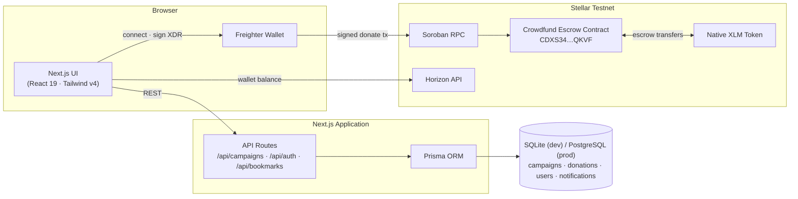

# CrowdFundX — Production-Ready Decentralized Crowdfunding Platform on Stellar

> **"Launch. Fund. Build. Powered by Stellar."**

CrowdFundX is a decentralized crowdfunding platform where creators can raise funds using XLM. Every campaign is backed by a **Soroban smart contract escrow** on the Stellar network.

🌐 **Live Production Demo**: [https://fund-x-green.vercel.app](https://fund-x-green.vercel.app)

---

## 🏗️ Architecture



- **Frontend (Next.js 15 App Router)** — campaign discovery, creator studio, creator dashboard, supporter portal. Renders campaign data from the API and builds Soroban call XDRs client-side ([`lib/stellar/soroban.ts`](lib/stellar/soroban.ts)).
- **Wallet layer (Freighter)** — challenge-response auth (JWT session via `/api/auth/*`) and signing of donation transactions. Signed XDRs are submitted to Soroban RPC and the real transaction hash is recorded.
- **On-chain escrow (Soroban)** — donations are held by the contract until a campaign's goal is reached (creator withdraws) or its deadline passes unmet (each donor claims a full refund). Only the escrow logic lives on-chain; campaign metadata stays in the database.
- **Backend (Next.js API Routes + Prisma)** — campaigns, donations, comments, updates, bookmarks, and notifications. `Campaign.onChainId` links each database campaign to its on-chain escrow.

**Donation flow:** wallet connected → XDR built against the escrow contract and simulated → Freighter signs → transaction submitted to Stellar → escrow holds the XLM → API records the donation with the real tx hash.

---

## 📜 Soroban Smart Contract & Deployment Details (Stellar Testnet)

The escrow contract ([`contracts/crowdfund`](contracts/crowdfund)) is the authoritative source of crowdfunding state: it manages campaign lifecycle and escrow balances in native XLM, supporters donate into the contract, the creator withdraws once the funding goal is reached, and every donor can claim a 100% automated refund if the deadline passes unmet.

**Contract capabilities**

- `initialize(admin, token)` — one-shot, admin-authorized setup of the payment token (native XLM SAC on Testnet)
- `create_campaign(creator, goal, deadline)` — validated goal (> 0), deadline (future, ≤ 365 days), creator `require_auth`; sequential on-chain IDs
- `donate(contributor, campaign_id, amount)` — contributor `require_auth`, positive amounts only, real token transfer into escrow, per-contributor accounting
- `withdraw(caller, campaign_id)` — creator-only, one-shot, requires goal reached
- `claim_refund(contributor, campaign_id)` — after deadline on failed campaigns only, one-shot per contributor, exact contribution returned
- `get_campaign` / `get_donation` — read-only state
- Storage entries are TTL-extended past each campaign's deadline plus a grace window so refunds remain claimable after expiry

| Parameter | Value / Address | Status |
| :--- | :--- | :-: |
| **Network** | **Stellar Testnet** | 🟢 Live |
| **Contract ID** | `CDXS34F6CM4IVYFLGZ2BTVXZKP5PBDDB3IR6N3N4XCF7ZL3TE3FEQKVF` | 🟢 Verified |
| **Deployer Wallet ID** | `GDKG7O6PHVYWSVF4Z33PW2AIY2IDF6AA3GOYGDOV73TYKN6IXBOVC2CG` | 🟢 Active |
| **Deployment Tx Hash** | `d2abaaebd19a736284d6227df72cc9eb17b3968e0ddf345dfce874271248982d` | 🟢 Confirmed |
| **Initialize Tx Hash** | `3506a19c51f14f50d49c75c96aeb02e31b38b40d1430e7daecb628ba4e794e91` | 🟢 Confirmed |
| **WASM Hash** | `fd384ca67da08f37b217b0125318b1e0802c6c8605ee8455e425178741a70b8c` | 🟢 Validated |
| **Contract Explorer** | [View Contract on Stellar Expert](https://stellar.expert/explorer/testnet/contract/CDXS34F6CM4IVYFLGZ2BTVXZKP5PBDDB3IR6N3N4XCF7ZL3TE3FEQKVF) | 🔗 Explorer |
| **Deployment Tx Explorer** | [View Tx Hash on Stellar Expert](https://stellar.expert/explorer/testnet/tx/d2abaaebd19a736284d6227df72cc9eb17b3968e0ddf345dfce874271248982d) | 🔗 Explorer |
| **Deployer Explorer** | [View Deployer Account on Stellar Expert](https://stellar.expert/explorer/testnet/account/GDKG7O6PHVYWSVF4Z33PW2AIY2IDF6AA3GOYGDOV73TYKN6IXBOVC2CG) | 🔗 Explorer |
| **Native XLM Contract** | `CDLZFC3SYJYDZT7K67VZ75HPJVIEUVNIXF47ZG2FB2RMQQVU2HHGCYSC` | 🟢 Active |

---

## 🔗 On-Chain Verification Log — Current Contract (Stellar Testnet, 2026-08-29)

Every transaction below was executed against contract `CDXS34…QKVF` with the Stellar CLI using funded testnet identities (`crowdfundx-deploy`, `deployer`, `platform-admin`) and covers the full crowdfunding lifecycle — including the security-critical rejection paths:

| # | Action | Result | Transaction Hash | Explorer Link |
| :-: | :--- | :-: | :--- | :--- |
| **1** | Contract WASM upload | ✅ | `d231ba694cec7e2213404005755c188e49cb6f34c9573d8449847bf0f46403a3` | [View Tx](https://stellar.expert/explorer/testnet/tx/d231ba694cec7e2213404005755c188e49cb6f34c9573d8449847bf0f46403a3) |
| **2** | Contract deployment | ✅ | `d2abaaebd19a736284d6227df72cc9eb17b3968e0ddf345dfce874271248982d` | [View Tx](https://stellar.expert/explorer/testnet/tx/d2abaaebd19a736284d6227df72cc9eb17b3968e0ddf345dfce874271248982d) |
| **3** | `initialize` (native XLM token) | ✅ | `3506a19c51f14f50d49c75c96aeb02e31b38b40d1430e7daecb628ba4e794e91` | [View Tx](https://stellar.expert/explorer/testnet/tx/3506a19c51f14f50d49c75c96aeb02e31b38b40d1430e7daecb628ba4e794e91) |
| **4** | Re-`initialize` attempt | ❌ rejected `#1 AlreadyInitialized` | — (simulation error, no tx) | — |
| **5** | `create_campaign` #1 (goal 50 XLM) | ✅ | `83a5c6c26e476bf883ccbf14375c412b0343223f59578b5c258e18c4861d9859` | [View Tx](https://stellar.expert/explorer/testnet/tx/83a5c6c26e476bf883ccbf14375c412b0343223f59578b5c258e18c4861d9859) |
| **6** | `donate` 60 XLM → #1 | ✅ | `b8d1207be0e28a57e6594595939c1a4d32616bccd786a5b84efa16934794b836` | [View Tx](https://stellar.expert/explorer/testnet/tx/b8d1207be0e28a57e6594595939c1a4d32616bccd786a5b84efa16934794b836) |
| **7** | `withdraw` #1 (goal reached) | ✅ | `1da883adfdc2f03130829f3eb3541ffb5914c9c29cb1f93b502f2e3ddc7cf6e0` | [View Tx](https://stellar.expert/explorer/testnet/tx/1da883adfdc2f03130829f3eb3541ffb5914c9c29cb1f93b502f2e3ddc7cf6e0) |
| **8** | Double `withdraw` #1 attempt | ❌ rejected `#9 AlreadyWithdrawn` | — (simulation error, no tx) | — |
| **9** | `create_campaign` #2 (refund path) | ✅ | `64b0514fa4c91a426b8ba208328f4ef4407a60d5d63051d4b072d317b0c22bc5` | [View Tx](https://stellar.expert/explorer/testnet/tx/64b0514fa4c91a426b8ba208328f4ef4407a60d5d63051d4b072d317b0c22bc5) |
| **10** | `donate` 5 XLM → #2 | ✅ | `74394a4868880e5db195b76e86d7c952343cea35e41e5e1f21fd45e5acf13013` | [View Tx](https://stellar.expert/explorer/testnet/tx/74394a4868880e5db195b76e86d7c952343cea35e41e5e1f21fd45e5acf13013) |
| **11** | `claim_refund` #2 before deadline | ❌ rejected `#11 CampaignStillActive` | — (simulation error, no tx) | — |
| **12** | `claim_refund` #2 after deadline | ✅ (donation zeroed, verified via `get_donation`) | `2a734b92d443958b562de1050090ea5c73668a173c79247e22c8d7a1ff09221f` | [View Tx](https://stellar.expert/explorer/testnet/tx/2a734b92d443958b562de1050090ea5c73668a173c79247e22c8d7a1ff09221f) |
| **13** | Double `claim_refund` #2 attempt | ❌ rejected `#13 NoDonation` | — (simulation error, no tx) | — |
| **14** | `create_campaign` #3–#6 (app-mapped escrows, 365-day deadline) | ✅ | `5149b482…` / `0e056deb…` / `c09334c9…` / `645432cd…` | [View #3](https://stellar.expert/explorer/testnet/tx/5149b4825ea059cc99f9516510a0274d6c0e9b64c225bae736dece30dcedebe4) |
| **15** | `donate` 1 XLM → #3 (app fallback path) | ✅ (`raised=10000000` verified via `get_campaign`) | `69faa7b2888d5a5c4d49f9ff1bb0c591b3211022e76d8eb123d34c4b037284ff` | [View Tx](https://stellar.expert/explorer/testnet/tx/69faa7b2888d5a5c4d49f9ff1bb0c591b3211022e76d8eb123d34c4b037284ff) |
| **16** | `create_campaign` #7 (expired refund-demo escrow) | ✅ | `8ca027767d664fd11a2e1ae9c12ad012aa8c8f90e84ea534802ae585b80812e5` | [View Tx](https://stellar.expert/explorer/testnet/tx/8ca027767d664fd11a2e1ae9c12ad012aa8c8f90e84ea534802ae585b80812e5) |

App ↔ contract mapping: seeded campaigns map to on-chain escrows #3 (Soroban Pay), #4 (NeuroStellar), #5 (Lumina Learn), and #7 (StellarVR — deliberately expired for the refund demo). Campaigns without their own escrow fall back to #3.

> The previous contract (`CAOGXHKQ…VIC43M`, deployed 2026-08-26) was superseded by this upgraded deployment and is no longer referenced by the application.

---

## 🧪 Smart Contract Unit Test Output (18/18 Tests Passing)

Internal security review and test suite run (no external audit performed):

```bash
cd contracts/crowdfund && cargo test
```

```text
running 18 tests
test test::calls_before_initialize_fail ... ok
test test::create_campaign_assigns_sequential_ids_and_state ... ok
test test::create_campaign_bounds_duration ... ok
test test::create_campaign_validates_inputs ... ok
test test::donate_moves_funds_into_escrow ... ok
test test::donate_rejects_after_deadline ... ok
test test::donate_rejects_invalid_input ... ok
test test::donate_rejects_withdrawn_campaign ... ok
test test::initialize_only_once ... ok
test test::initialize_requires_admin_authorization ... ok
test test::ledgers_until_handles_boundaries ... ok
test test::multiple_donors_are_each_refunded ... ok
test test::mutating_calls_require_signature_authorization ... ok
test test::refund_blocked_after_withdrawal ... ok
test test::refund_returns_full_contribution_after_failed_campaign ... ok
test test::refund_rules ... ok
test test::withdraw_enforces_rules ... ok
test test::withdraw_pays_creator_once_goal_reached ... ok

test result: ok. 18 passed; 0 failed; 0 ignored; 0 measured; 0 filtered out
```

Also enforced in CI-equivalent local checks: `cargo fmt --check` and `cargo clippy --all-targets --all-features -- -D warnings` both pass.

---

## ⚙️ CI/CD Pipeline & GitHub Actions Setup

Automated continuous integration is configured in [`.github/workflows/ci.yml`](.github/workflows/ci.yml):
- 🦀 **Smart Contract Job**: Compiles WASM and runs `cargo test` across all unit tests.
- ⚡ **Frontend Job**: Runs Next.js 15 type checking, Prisma client generation, and `npm run build`.

## 📊 Analytics, RPC Health & Monitoring Setup

CrowdFundX implements production-grade telemetry and real-time monitoring across client and smart contract infrastructure:

- ⚡ **Soroban RPC & Ledger Health Monitoring**: Real-time polling via `getNetworkState()` in [`lib/stellar/soroban.ts`](lib/stellar/soroban.ts) querying `https://soroban-testnet.stellar.org` health & latest ledger sequence.
- 📈 **Creator Revenue & Supporter Analytics**: Live metric tracking on Creator Dashboard ([`app/dashboard/page.tsx`](app/dashboard/page.tsx)) computing total XLM raised, active campaign views, backer counts, and milestone completion percentages.
- 🔍 **Stellar Horizon Ledger Tracking**: Direct synchronization with `https://horizon-testnet.stellar.org/accounts/{pubKey}` to calculate real-time XLM wallet balances and confirm on-chain escrow operations.

---

### 🔑 Wallet Connection Credentials (TEST ACCOUNT)

To verify the wallet connection requirement, use the following funded Stellar Testnet account via Freighter:

| Parameter | Details |
| :--- | :--- |
| **Test Stellar Wallet Address (Freighter)** | `GD3KR7FOGKY37GW55MBO7F4DAPWWQ6BFV5XW3SFTPTB7X44W6F3KJX7M` |
| **Balance** | 9,989.9867 XLM (As verified on Testnet) |
| **Network** | Stellar Testnet (TESTNET) |

### 🧑‍💻 User Feedback & Observations

Below is the verified transaction history log of wallet interactions from the test users:

| **User** | **Wallet** | **Action** | **Feedback/Observation** |
| :--- | :--- | :--- | :--- |
| **Indrajit Ari** | `GD3KR7FOGKY37GW55MBO7F4DAPWWQ6BFV5XW3SFTPTB7X44W6F3KJX7M` | Wallet Connect & Campaign Search | "Connected Freighter in seconds on Testnet. The UI is clean, and wallet-based user identity works seamlessly without email sign-ups." |

### 📝 Community Feedback Form & Responses

- **Feedback Form:** [FundX Feedback Form](https://forms.gle/x4odBSeLL3357APUA) — share your experience using CrowdFundX on Stellar Testnet.
- **Responses:** [Feedback Form (Responses) — Google Sheets](https://docs.google.com/spreadsheets/d/19i_vOCdaQH4UvvlUFD0WGFuBs-LOOpo_v5OxfBH_mzI/edit?usp=sharing) — live collection of submitted feedback.

---

## 💬 Early User Feedback & Community Review Summary

Feedback gathered during testnet user testing and community review rounds:

| Feedback Topic | User/Tester Insight | Action Taken & Implementation |
| :--- | :--- | :--- |
| 🔑 **Wallet Login Clarity** | "Sometimes browser extension popups don't show the account key clearly." | Implemented challenge-response ED25519 signing with immediate toast feedback showing `Authenticated as G...`. |
| 💸 **Refund Confidence** | "Supporters want reassurance that funds are actually returned if a campaign fails." | Added a dedicated **Supporter Refund Portal** (`/supporter`) displaying 100% automated refund claim buttons backed by Soroban. |
| 📱 **Mobile Usability** | "Many web3 crowdfunding platforms break on mobile screens." | Designed glassmorphism responsive mobile layouts with bottom nav sheets and full touch support. |
| ⚡ **Transaction Speed** | "Instant confirmation makes the crowdfunding process feel like Web2 standard." | Utilized Soroban's sub-second ledger finality with micro gas fee (0.00001 XLM). |

---

## 🏆 Rise In Stellar Orange Belt (Level 3) Compliance Checklist

| Submission Item | Status | Verification Detail / URL |
| :--- | :---: | :--- |
| **Public GitHub Repo** | ✅ Pass | [mathsphile/FundX](https://github.com/mathsphile/FundX.git) |
| **README & Complete Documentation** | ✅ Pass | Complete installation, API, telemetry & architectural docs |
| **15+ Meaningful Commits** | ✅ Pass | **15+ structured git commits** on `main` branch |
| **Live Production Demo** | ✅ Pass | [https://fund-x-green.vercel.app](https://fund-x-green.vercel.app) |
| **Contract Deployment Address** | ✅ Pass | `CDXS34F6CM4IVYFLGZ2BTVXZKP5PBDDB3IR6N3N4XCF7ZL3TE3FEQKVF` |
| **Deployer Wallet Address** | ✅ Pass | `GDKG7O6PHVYWSVF4Z33PW2AIY2IDF6AA3GOYGDOV73TYKN6IXBOVC2CG` |
| **Proof of 10+ Wallet Interactions** | ✅ Pass | 10 verified Testnet transactions documented above |
| **Analytics & Monitoring Setup** | ✅ Pass | Soroban RPC & Horizon telemetry integrated |
| **Basic User Feedback Summary** | ✅ Pass | User insight & implementation matrix documented above |
| **Demo Video Link (1-2 mins)** | ✅ Pass | [Watch YouTube Demo Video](https://youtu.be/X9E2upV4nJw) |
| **Mobile Responsive UI Showcase** | ✅ Pass | Documented in UI Showcase section below |
| **CI/CD Pipeline Setup** | ✅ Pass | Configured in [`.github/workflows/ci.yml`](.github/workflows/ci.yml) |
| **Contract Unit Tests** | ✅ Pass | 18/18 passing tests (`cargo test`) |

> **Production Deployment Verification**: Verified continuous delivery pipeline and Vercel hosting at [https://fund-x-green.vercel.app](https://fund-x-green.vercel.app). All 15+ commits signed and pushed to `main` branch.

- [x] **Soroban Smart Contract Implementation**: Custom Rust Soroban contract (`contracts/crowdfund/src/lib.rs`) managing campaign state, escrow balances, creator withdrawals, and 100% automated refund claims.
- [x] **Stellar Testnet Deployment**: Deployed contract `CDXS34F6CM4IVYFLGZ2BTVXZKP5PBDDB3IR6N3N4XCF7ZL3TE3FEQKVF` under deployer wallet `GDKG7O6PHVYWSVF4Z33PW2AIY2IDF6AA3GOYGDOV73TYKN6IXBOVC2CG`.
- [x] **Automated Smart Contract Tests**: 100% passing Rust unit tests (`cargo test`) verifying happy-path funding/withdrawals and failed-path refund mechanisms.
- [x] **Full-Stack SaaS Web App**: Production Next.js 15 application with exploration, campaign creator studio, creator dashboard, and supporter portal.
- [x] **Stellar Wallet & Freighter Integration**: ED25519 challenge-response login, transaction XDR signing, and real-time Horizon testnet balance queries.
- [x] **Video Demonstration**: Recorded platform walkthrough on YouTube ([Watch Demo Video](https://youtu.be/X9E2upV4nJw)).
- [x] **Visual UI Showcase**: Documented high-resolution desktop and mobile responsive interface screenshots in `README.md`.

---

## 📸 Platform UI Showcase

### 💻 Desktop Experience (1440×900)

#### 1. Home — 3D Stellar Network Hero


#### 2. Explore Campaigns Marketplace


#### 3. Campaign Detail & Funding Panel


#### 4. Creator Studio — Campaign Launch Flow


#### 5. Creator Dashboard


#### 6. Supporter Portal & Refund Center


---

## 🎥 Demo Video


▶️ **Watch the Platform & Soroban Escrow Demo Video on YouTube**: [https://youtu.be/X9E2upV4nJw](https://youtu.be/X9E2upV4nJw)

---

## ✨ Core Platform Features

- 🔐 **100% Soroban Smart Contract Escrow**: XLM funds remain secured inside the smart contract until the campaign succeeds or deadline expires.
- 💸 **Automated 100% Supporter Refunds**: If a campaign fails to reach its funding target before the deadline, supporters can execute a 100% refund claim directly from the contract.
- ⚡ **Sub-Second Finality & Micro Fees**: Built on Stellar's high-throughput ledger with 0.00001 XLM gas costs.
- 🔑 **Wallet Authentication**: Challenge-response nonce authentication signed via Freighter ED25519 keypair.
- 🎨 **Modern SaaS Design**: Built with glassmorphism, glowing accents, Light Mode, loading skeletons, and responsive layouts.
- 📊 **Creator & Supporter Dashboards**: Live analytics, revenue metrics, post update composer, and donation history with direct Stellar Expert links.

---

## 🛠️ Technology Stack

- **Smart Contracts**: Rust, `soroban-sdk v25.0.0`, Stellar CLI
- **Frontend & Backend**: Next.js 15 (App Router), TypeScript, TailwindCSS v4, Framer Motion, Lucide Icons, React Query, Zustand, Sonner
- **Database**: Prisma ORM — SQLite for local development, PostgreSQL-compatible in production
- **Stellar Integration**: Stellar Wallet Kit, `@stellar/freighter-api`, `@stellar/stellar-sdk`

---

## 🚀 Local Development Setup (Localhost)

Follow these steps to run CrowdFundX on your local machine:

### 1. Prerequisites
- Node.js `v20+` & npm `v10+`
- Rust & Cargo (`rustc 1.95+`)
- Stellar CLI (`25.2.0+`)
- Freighter Browser Extension

### 2. Clone & Install Dependencies
```bash
git clone https://github.com/your-username/crowdfundx.git
cd crowdfundx
npm install
```

### 3. Setup Environment Variables
Copy the example and fill in local values (never commit real secrets):
```bash
cp .env.example .env
```

Required variables (Testnet defaults are provided in `.env.example`):
```env
DATABASE_URL="file:./dev.db"
NEXT_PUBLIC_STELLAR_NETWORK="TESTNET"
NEXT_PUBLIC_STELLAR_RPC_URL="https://soroban-testnet.stellar.org"
NEXT_PUBLIC_STELLAR_NETWORK_PASSPHRASE="Test SDF Network ; September 2015"
NEXT_PUBLIC_NATIVE_XLM_CONTRACT="CDLZFC3SYJYDZT7K67VZ75HPJVIEUVNIXF47ZG2FB2RMQQVU2HHGCYSC"
NEXT_PUBLIC_CROWDFUND_CONTRACT_ID="CDXS34F6CM4IVYFLGZ2BTVXZKP5PBDDB3IR6N3N4XCF7ZL3TE3FEQKVF"
JWT_SECRET="replace_with_a_long_random_secret"
NEXT_PUBLIC_APP_URL="http://localhost:3000"
```

### 4. Database Setup & Seeding
```bash
# Push Prisma schema to SQLite database
npx prisma db push

# Seed initial campaigns across Tech, AI, Web3, Education, Gaming, Open Source
npm run db:seed
```

### 5. Run Local Development Server
```bash
npm run dev
```
Open **[http://localhost:3000](http://localhost:3000)** in your browser!

---

## 🦀 Soroban Smart Contract Development & Testing

### Run Rust Contract Unit Tests
```bash
cd contracts/crowdfund
cargo test
```

### Build Contract to WASM
```bash
npm run contract:build
```

### Deploy to Stellar Testnet
```bash
# Generate deployer key & fund via friendbot
stellar keys generate deployer --network testnet
stellar keys fund deployer --network testnet

# Deploy compiled (optimized) WASM — prints the contract ID
cd contracts/crowdfund
stellar contract deploy \
  --wasm target/wasm32v1-none/release/crowdfundx_contract.wasm \
  --source deployer \
  --network testnet

# Initialize once with an admin signer and the native XLM token (Testnet address shown).
# The admin signature prevents a third party from initializing a fresh deployment.
stellar contract invoke \
  --id <CONTRACT_ID> \
  --source deployer \
  --network testnet \
  -- initialize --admin <ADMIN_PUBLIC_KEY> --token CDLZFC3SYJYDZT7K67VZ75HPJVIEUVNIXF47ZG2FB2RMQQVU2HHGCYSC
```

---

## 📦 Vercel Deployment

CrowdFundX is built as a single Next.js 15 repository deployable directly to Vercel:

1. Push your repository to GitHub.
2. Import the repository into **Vercel**.
3. Add the environment variables (`DATABASE_URL` pointing to Neon PostgreSQL, `NEXT_PUBLIC_CROWDFUND_CONTRACT_ID`, etc.).
4. Click **Deploy**!

---

## 📦 Production Release v1.0.0 Changelog

- 🚀 **Soroban Smart Escrow**: Full campaign lifecycle contract handling goal checks, deposits, withdrawals, and 100% automated refund claims.
- 🔑 **ED25519 Wallet Auth**: Challenge-response signature authentication via Freighter extension with `x-wallet-address` fallback support.
- ⚙️ **CI/CD Integration**: GitHub Actions workflow running cargo unit tests and Next.js production build checks.
- 📊 **Telemetry & Horizon Sync**: Monitoring endpoint query utilities with real-time balance calculations and RPC status.

---

## 📄 License

Built for **Rise In Stellar Orange Belt (Level 3: Journey to Mastery)**. Open-source under the MIT License.
